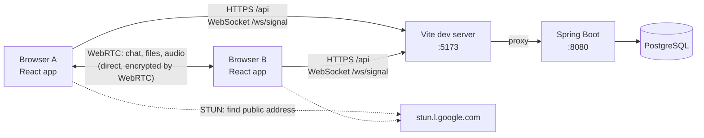

# PEER Messenger

A peer-to-peer messenger for the browser. Chat, files and audio calls go **directly between browsers** over WebRTC; the server only introduces people to each other, keeps accounts and contacts, and holds an **end-to-end encrypted** copy of each message for 24 hours so offline contacts still receive it.

Built step by step from the tutorial *Building a P2P Messenger*, Phases 1–6, plus an encrypted message store, a redesigned UI and tunnel sharing.

## Features

- **Accounts and contacts**: sign up, log in, search people by name or username, and add them as contacts.
- **Live presence**: green dots show which contacts are online, updated instantly.
- **Direct chat**: messages travel browser to browser with delivery ticks (sent ✓, delivered ✓✓) and unread badges.
- **Offline delivery and history**: an end-to-end encrypted copy of each message is kept for 24 hours, so history survives a refresh and contacts who were offline get their messages when they're back. The server can't read them.
- **File sharing**: send files up to 500 MB directly, with progress, pause and resume from either side, cancel, a SHA-256 check on arrival, and resume after a dropped connection.
- **Audio calls**: ring, accept or decline, mute, hang up, a 30-second no-answer timeout, an automatic busy reply, and a call history tab. Chat and file transfers keep working during a call.
- **Polished UI**: light and dark themes, a three-column layout on desktop and a single-screen layout on phones.

## How it works



1. **Signing in**: the backend checks the password (bcrypt) and returns a JWT. The browser sends it on every API call and when it opens the signaling WebSocket.
2. **Presence and signaling**: each signed-in browser keeps one WebSocket open to `/ws/signal`. The server tracks who is online, tells contacts when that changes, and relays `signal` messages between two users without reading them.
3. **Connecting**: to talk to someone, the two browsers exchange WebRTC offers, answers and network candidates through that relay. They use the "perfect negotiation" pattern, so either side can start, even both at once.
4. **Talking**: once connected, a `chat` data channel carries messages and file control frames, each file gets its own `file:<id>` data channel, and calls add audio tracks to the same connection. None of this passes through the server.
5. **Storing**: each message is also encrypted in the browser and uploaded, so it can be delivered later or reloaded after a refresh. Stored copies expire after 24 hours.

### What the server can and can't see

| The server sees | The server never sees |
| --- | --- |
| Accounts, contacts, who is online | Message text (only ciphertext is stored) |
| Who messaged whom and when (for stored messages) | Files (they go directly between browsers) |
| Call log: who called whom, when, how long | Call audio |
| Connection log: when each user connected | Your private key (it never leaves your browser) |

**How the encryption works.** Each browser creates an ECDH P-256 key pair. The private key is non-extractable and kept in IndexedDB; the public key is published to the server. Both people derive the same AES-GCM key from their own private key and the other's public key (ECDH, then HKDF). The message ID and both user IDs are covered by the integrity check, so the server can't move a message into another conversation.

## Tech stack

| Area | Technologies |
| --- | --- |
| Frontend | React 19, TypeScript, Vite; WebRTC and Web Crypto built into the browser, no extra libraries |
| Backend | Java 21, Spring Boot 4, Spring Security (JWT with JJWT), Spring WebSocket, Spring Data JPA and JdbcTemplate |
| Database | PostgreSQL 16, Flyway migrations |
| Infrastructure | Docker Compose |

## Getting started

You need Docker with Docker Compose. From the project root, run:

```bash
docker compose -f infrastructure/docker-compose.yml up --build
```

Then open http://localhost:5173 and create an account.

**Trying it with two people on one computer.** A browser keeps one login and one encryption key per site, so sign the second person in from a **different browser** or a **private window**. Two tabs in the same window would both be the same user.

Other addresses:

| URL | What it shows |
| --- | --- |
| http://localhost:5173 | The app |
| http://localhost:8080/api/ping | Backend ping endpoint |
| http://localhost:8080/actuator/health | Backend and database health |

Microphones only work on `localhost` or HTTPS. To use calls from another device, share the app through a tunnel (below), which provides HTTPS.

## Configuration

Settings come from `infrastructure/.env`, which Docker Compose reads automatically. Copy `infrastructure/.env.example` to start. Every value has a default for local development.

| Variable | Default | What it does |
| --- | --- | --- |
| `JWT_SECRET` | a placeholder in `docker-compose.yml` | Signs login tokens. **Set your own before anyone else can reach the app**: `openssl rand -base64 48`. Changing it signs everyone out. |
| `CORS_ORIGINS` | `http://localhost:5173` | Browser origins allowed to use the API and WebSocket, comma-separated. Wildcards like `https://*.trycloudflare.com` are allowed. |
| `DB_USER`, `DB_PASSWORD` | `p2p` / `p2p` | Database login. Postgres only applies these when it first creates its data volume, so don't change them on an existing database. |

Logins last 12 hours (`app.jwt.ttl` in `be-p2p/src/main/resources/application.yaml`).

## Sharing it over the internet (Cloudflare quick tunnel)

A quick tunnel gives your local app a temporary public `https://….trycloudflare.com` address, with no Cloudflare account needed. Only the frontend port is exposed; Vite forwards `/api` and `/ws` to the backend.

1. Create `infrastructure/.env` with a real JWT secret and the tunnel origins. The default secret is in this repo, so anyone could forge logins with it:

   ```bash
   cd infrastructure
   printf 'JWT_SECRET=%s\nCORS_ORIGINS=http://localhost:5173,https://*.trycloudflare.com\n' "$(openssl rand -base64 48)" > .env
   ```

2. Start (or restart) the stack so it picks up `.env`:

   ```bash
   docker compose up -d --build
   ```

3. Start the tunnel (install with `brew install cloudflared` if needed) and open the `https://….trycloudflare.com` address it prints:

   ```bash
   cloudflared tunnel --url http://localhost:5173
   ```

The address changes every time you start the tunnel; the wildcard in `CORS_ORIGINS` covers any of them. Stop the tunnel with Ctrl+C to take the app offline.

Things to know:
- Chat, files and calls still connect browser to browser. Two devices on very different networks (for example, mobile data behind strict NAT) may stay on "Connecting…" until a TURN server is added (Phase 8 of the tutorial).
- This serves the Vite development server, which is fine for demos but not built for heavy traffic.

## Developing without Docker

Run only the database in Docker, and the backend and frontend directly:

```bash
docker compose -f infrastructure/docker-compose.yml up -d postgres
```

```bash
cd be-p2p && ./mvnw spring-boot:run
```

```bash
cd fe-p2p && npm install && npm run dev
```

The backend connects to `localhost:5432` as `p2p`/`p2p`, and the Vite dev server forwards `/api` and `/ws` to `localhost:8080` (set `API_TARGET` to change that). Stop the Docker `frontend` and `backend` containers first if they're running, since they use the same ports.

## Checks and tests

```bash
cd fe-p2p && npm run lint && npm run build
```

`npm run build` also type-checks. The backend has one test, a Spring context check, which needs PostgreSQL running on `localhost:5432`:

```bash
cd be-p2p && ./mvnw test
```

There are no automated tests for the frontend or the WebRTC flows yet; they were tested by hand with two browsers.

## Project structure

```
be-p2p/                         Spring Boot backend
  src/main/java/com/example/p2p/
    auth/                       JWT creation and checks, for HTTP and the WebSocket handshake
    config/                     Security, CORS, WebSocket endpoint, safe error responses
    controllers/                REST endpoints: auth, users, contacts, calls, keys and messages
    session/                    Signaling handler, online-session registry, call log, push to browsers
    messages/                   Encrypted 24-hour message store and public key directory
    dbo/, dto/                  JPA entities and repositories, request and response records
  src/main/resources/
    application.yaml            Settings (each one commented)
    db/migration/               Flyway SQL migrations V1–V5
fe-p2p/                         React frontend
  src/
    pages/                      Landing and login, chat list, call history
    components/                 Chat window, file cards, call panel, avatars, icons
    hooks/                      Auth, signaling, peers (chat and files), calls, theme, ringtone
    webrtc/                     Peer connection with perfect negotiation, peer manager, chat protocol, file transfer
    crypto/                     End-to-end encryption for stored messages
    services/                   REST client and signaling WebSocket client
infrastructure/                 Docker Compose file and example .env
docs/                           Design docs (placeholders, not written yet)
```

## API reference

All endpoints except `/api/auth/*` and `/api/ping` need `Authorization: Bearer <token>`.

| Method and path | What it does |
| --- | --- |
| `POST /api/auth/register` | Create an account; returns a token and the user |
| `POST /api/auth/login` | Log in; returns a token and the user |
| `GET /api/users/me` / `PATCH /api/users/me` | Your profile / change your display name |
| `GET /api/users/search?q=` | Find people (2–32 characters, up to 20 results) |
| `GET /api/contacts` / `POST /api/contacts` / `DELETE /api/contacts/{userId}` | List, add (by username) or remove contacts |
| `GET /api/calls` | Your last 50 calls |
| `PUT /api/keys/me` / `GET /api/keys/{userId}` | Publish your browser's public key / get someone's |
| `POST /api/messages` / `GET /api/messages` | Store an encrypted message for a contact / fetch your last 24 hours |
| `GET /api/ping` | Health ping |

**WebSocket `/ws/signal?token=<jwt>`** (JSON messages):

| Direction | `type` | Meaning |
| --- | --- | --- |
| Browser → server | `ping` | Keep-alive, every 25 seconds |
| Browser → server | `signal` with `to` and `payload` | Relay to another user. Payload kinds: `description`, `ice`, `bye`, and `call-invite`, `call-accept`, `call-decline`, `call-busy`, `call-end` |
| Server → browser | `presence-snapshot`, `presence` | Who of your contacts is online, then changes |
| Server → browser | `signal` with `from` and `payload` | A relayed signal |
| Server → browser | `inbox`, `receipt` | A stored message is waiting / your stored messages were delivered |
| Server → browser | `error`, `pong` | For example `peer-offline` / keep-alive reply |

Opening the app in a second tab closes the first tab's WebSocket with code 4000, and the first tab offers **Use here** to take it back.

## Database

| Migration | Tables |
| --- | --- |
| `V1__baseline` | none (Flyway starting point) |
| `V2__users_contacts` | `users`, `contacts` (one-way: "I added them"), `devices` (not used yet) |
| `V3__connections` | `connections`: a log of signaling sessions |
| `V4__call_sessions` | `call_sessions`: the call log, filled in from relayed call signals |
| `V5__stored_messages` | `user_keys`, `stored_messages`: public keys and encrypted messages (24 hours) |

Never edit a migration that has already run; Flyway checks their checksums at startup. Add a new `V6__…` file instead.

## Known limitations

- **No TURN server yet.** Peers that can't reach each other directly (strict NAT, some mobile networks) can't connect. Same Wi-Fi or ordinary home networks work.
- **One browser per account for stored messages.** History encrypted for one browser can't be read in another, and logging in elsewhere moves new messages to that browser. Users must log in once with the current version before they can receive offline messages.
- **Encryption scope.** Keys are static (no forward secrecy), and there's no way yet to verify that a contact's public key is genuine. The server can see metadata: who, to whom, when.
- **Not stored:** files, call audio, and whether you've read a message (unread badges reset on refresh).
- **Limits:** files up to 500 MB, held in the receiver's memory until they're checked. Resuming a transfer needs the sender's tab to stay open.
- **Video calls**, push notifications and a production build are not built yet.

## Roadmap

The next tutorial phases:

| Phase | What it adds |
| --- | --- |
| 7. Video calling | Camera calls with camera switching, screen sharing and a quality indicator |
| 8. NAT traversal | A TURN server (coturn) so peers connect on difficult networks, and recovery from network drops |
| 9. Security and reliability | Only contacts can signal you, single-use WebSocket tickets instead of tokens in the URL, device revocation |
| 10. Production | Deployment over HTTPS and secure WebSockets, backups, monitoring and load testing |
